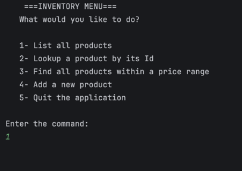

# Accounting Ledger

The accounting ledger is an app designed for a user to efficiently be able to check their financial transaction history. 
It will show the user payments and deposits, filtering by date, by vendor, or all together.

## Features

- Make payments and deposits
- Display all transactions filtering by:
  1. Month to date
  2. Previous Year/Month
  3. Current Year
  4. Vendor

## How to run it

1. Clone the repository and open it in IntelliJ
2. Run 'App.java'
3. Pick options D,P,L, or X from home screen
4. Payments or deposits will ask for pertinent information needed to add transaction to database
5. Choosing ledger option will allow you to see reports based on:
   1. Transaction type (ie. Deposit or payments)
   2. Previous month/year or month/year to date
   3. Search by vendor name

## Screen Map
```
MAIN
|
└── runHomeScreen()
    |           -- D) Add Deposit    → addDeposit()
    |           -- P) Make Payment   → makePayment()
    |           -- L) Ledger         → runLedgerScreen()
    |           -- X) Exit
    |
    └── runLedgerScreen()
                 |      -- A) All       → displayAll()
                 |      -- D) Deposits  → displayDeposits()
                 |      -- P) Payments  → displayPayments()
                 |      -- R) Reports   → runReportScreen()
                 |      -- H) Home      → back to Home
                 |
                 └── runReportsScreen()
                       |        -- 1) Month To Date    → displayMonthToDate()
                       |        -- 2) Previous Month   → displayPreviousMonth()
                       |        -- 3) Year To Date     → displayYearToDate()
                       |        -- 4) Previous Year    → displayPreviousYear()
                       |        -- 5) Search by Vendor → searchVendor()
                       |        -- 0) Back             → back to Ledger
```

## Screenshots




## Interesting code

One piece of code I'm proud of is this method that will display the previous month. 
It took a lot of thinking at first to figure out how to display it correctly if the month was January!

```java
public static void  displayPreviousMonth() {
    
    LocalDate currentDate = LocalDate.now();
    LocalDate previousDate = currentDate.minusMonths(1);
    
    for (Transaction transaction : transactions) {
        if (transaction.getDate().getMonthValue() == previousDate.getMonthValue() &&
                transaction.getDate().getYear() == previousDate.getYear()) {
            System.out.println(transaction.toString());
        }
    }
    pressEnterToContinue();
}
```

## Author

JohnPaul Morris, Year Up Java Academy